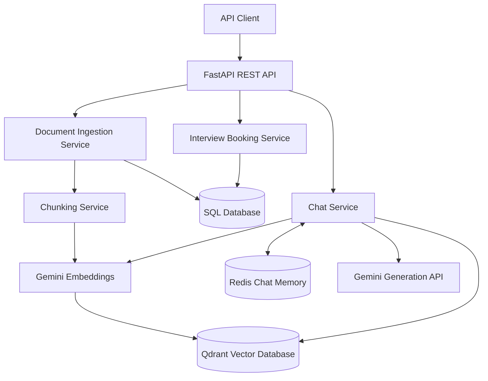

# Palm Mind AI — RAG Backend System Design

## 1. Project Overview

Palm Mind AI is a REST API backend that supports document ingestion, retrieval-augmented generation (RAG), multi-turn conversations, and interview booking.

The backend uses FastAPI, Google Gemini, Qdrant, Redis, and SQLAlchemy. It accepts PDF and TXT documents, splits extracted text into chunks, creates embeddings, and stores vectors for semantic retrieval.

## 2. System Architecture



## 3. Technology Stack

- **FastAPI:** REST API endpoints and request validation.
- **Google Gemini:** Text embeddings and response generation.
- **Qdrant:** Vector storage and similarity search.
- **Redis:** Conversation history and temporary interview-booking state.
- **SQLAlchemy:** Database access and ORM models.
- **SQLite:** Local relational database configuration; PostgreSQL can be configured through the database URL.
- **pypdf:** PDF text extraction.
- **LangChain Text Splitters:** Recursive text chunking.
- **Pytest:** Automated tests.

## 4. Document Ingestion Pipeline

1. A client uploads a PDF or TXT file to the document ingestion endpoint.
2. The API validates the file type, file size, and chunking parameters.
3. The ingestion service extracts text from the uploaded file.
4. The chunking service splits the text using the selected strategy:
   - `fixed_size`
   - `recursive`
5. The embedding service generates vector representations of the chunks.
6. The vector store saves the vectors and associated payload metadata in Qdrant.
7. The SQL database stores document metadata, including the document ID, filename, file type, chunking strategy, and chunk count.
8. The API returns an ingestion result to the client.

## 5. Conversational RAG Pipeline

1. The client sends a message and a session ID to the chat endpoint.
2. The service retrieves recent conversation history from Redis.
3. The embedding service converts the current query into a vector.
4. Qdrant retrieves relevant document chunks using similarity search.
5. The generation service constructs a prompt using the query, retrieved context, and conversation history.
6. Google Gemini generates the response.
7. The service stores the user message and assistant response in Redis.
8. The API returns the answer and session ID.

The RAG flow is implemented explicitly rather than relying on a `RetrievalQAChain`.

## 6. Conversation Memory

Redis stores messages under a session-specific key. The current implementation retains a limited number of recent messages and applies an expiration time.

Interview-booking state is also stored in Redis so that information supplied across multiple turns can be combined.

## 7. Interview Booking

The chat interface supports collecting the following information:

- Candidate name
- Email address
- Interview date
- Interview time

The booking flow asks for missing information, validates the collected details, and saves completed bookings in the relational database.

Dedicated REST endpoints also allow clients to create a booking and retrieve a booking by its ID.

## 8. Data Storage

### Qdrant

Stores embedded document chunks and their payload metadata for semantic retrieval.

### Redis

Stores recent conversation history and temporary booking state. These keys expire after the configured retention period.

### Relational Database

Stores document metadata and interview bookings using SQLAlchemy models.

## 9. API Endpoints

| Method | Endpoint | Purpose |
|---|---|---|
| GET | `/health` | Health check |
| POST | `/api/v1/documents/ingest` | Upload and index a document |
| POST | `/api/v1/chat` | Send a conversational message |
| POST | `/api/v1/bookings` | Create an interview booking |
| GET | `/api/v1/bookings/{booking_id}` | Retrieve a booking |

Interactive API documentation is available at `/docs` while the application is running.

## 10. Error Handling and Validation

The API uses Pydantic schemas and FastAPI request validation. Document ingestion validates supported formats and chunking parameters. Booking creation validates required fields, email addresses, and interview dates.

External service failures should be handled with clear API errors and appropriate logging. Production deployment should also include request timeouts, retry limits, rate limiting, and monitoring.

## 11. Security Considerations

- Store API keys and service credentials in environment variables.
- Never commit `.env` files or credentials to version control.
- Validate uploads and enforce file-size limits.
- Apply authentication and authorization before production use.
- Avoid logging sensitive candidate information.
- Use HTTPS and restrict access to databases and external services.

## 12. Testing

Run the automated tests with:

```bash
python -m pytest tests -v
```

Compile the application modules with:

```bash
python -m compileall app
```

The current automated tests cover booking-detail extraction and follow-up question behavior. Additional integration tests should cover document ingestion, vector retrieval, chat memory, and booking API endpoints.

## 13. Future Improvements

- Add integration tests using isolated test services.
- Improve date and time extraction for natural-language inputs.
- Add authentication, rate limiting, and structured logging.
- Add document deletion and re-indexing endpoints.
- Improve retrieval quality with metadata filtering and configurable similarity thresholds.
- Add deployment configuration, health monitoring, and CI checks.
